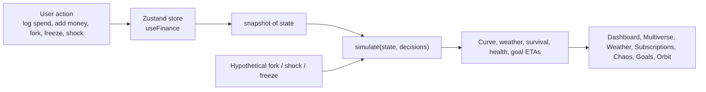

# AFTER₹10

**See the consequences before you spend.**

A browser-based personal finance simulator for Gen Z. It turns a ₹10,000, 30-day budget into one connected model, so every decision shows its effect on balance, daily allowance, goals, forecast, risk and health score before the money is spent.

> **Status:** hackathon prototype. Runs entirely in the browser with seeded demo data. No backend, no accounts, no real bank connection.
> **Demo / repository links:** _not provided — add yours here._

---

## Preview

Screenshots are not committed to the repository yet. Suggested captures to add under `docs/` and link here:

| Suggested capture | Shows |
|---|---|
| `docs/home.png` | Home dashboard: stat cards, weather strip, risk-fan chart, health breakdown |
| `docs/multiverse.png` | Three forks compared against Reality, with the regret meter |
| `docs/orbit.png` | Orbit view with an asteroid (a considered purchase) |

---

## Overview

Most budgeting apps log what already happened. AFTER₹10 answers forward-looking questions instead:

- Can I afford this without hurting my essentials?
- How much can I safely spend per day?
- What happens if something unexpected hits?
- Will I still reach my savings goal?

**Intended users:** students and early earners living on a fixed monthly allowance or stipend.

## Problem and Approach

Fixed allowances run out because recurring costs are easy to forget, daily spending feels small, and purchases are judged in isolation. Dividing ₹10,000 by 30 ignores bills and savings.

The app addresses this with a single pure function, `simulate(state, decisions)` in `src/core/engine.js`. Every screen reads its output, so a change anywhere (a purchase, a frozen subscription, new income, a shock) updates every number consistently. Hypothetical decisions are passed as an argument and never modify the saved state until committed.

> This is an educational/hackathon model, not financial advice. The figures come from a simplified simulation, not from real transaction data.

## Features

All features below are implemented in the current code.

| Feature | What it does |
|---|---|
| **Home dashboard** | Balance, safe daily spend, first goal progress, health score, risk level, 30-day weather strip, projected balance chart, health breakdown, spending-by-category donut, upcoming bills and income, generated insights. |
| **Money Multiverse** | Enter a purchase and run "Run simulation" to create three forks: *Buy now*, *Wait 2 weeks*, *Cheaper option* (60% of the price). Each fork shows safe daily spend, month-end balance, goal ETA delay, health and risk as deltas against Reality, plus a regret meter ("costs X days of safe spending"). Up to 3 forks at once; commit one or discard. |
| **Money Weather** | Each future day is rated Good / Okay / Rain / Storm from projected cushion (days of spending left after goal money). Bills appear as markers; forks can be selected to see which days get worse. A storm-shield bar shows whether a surprise ₹1,000 is absorbed. |
| **Risk fan chart** | Shows the likely balance range (10th to 90th percentile) from 300 simulated months, with Reality and fork lines overlaid. |
| **Add money / Log spend** | Add income received today or scheduled for a later day; log spending by category. Daily pace is derived from logged spending. |
| **Subscriptions** | Toggle, multi-select and pause subscriptions, with the runway gain shown before pausing. Add new subscriptions. |
| **Chaos Cards** | Preview the impact of shocks (repairs, refunds, freelance payout, a "Worst week" stress test) on month-end balance, daily spend, survival and health, then optionally apply them. |
| **Savings Goals** | Progress rings, ETA against a target window, "days unlocked" framing, contribute ₹500, create new goals. |
| **Days of Life** | Converts any price into days of runway. |
| **Orbit** | Visual metaphor: balance is the sun, goals are planets, subscriptions are moons, a slider adds a purchase as an asteroid and goal orbits move with their ETA. |
| **Reactive background** | The page background colour shifts with the health score. |
| **Persistence** | State is saved in `localStorage` (key `after10-v2`). |

## How It Works



Inside `simulate()`:

1. **Safe daily spend** = (balance + incoming money − upcoming bills − goal reserve − decisions) ÷ days left.
2. **Balance curve** deducts daily pace, bills and decisions per day and adds scheduled income.
3. **Monte Carlo:** 300 paths vary daily spend (70–130% of pace) and add a 5% daily chance of a ₹300–₹1,500 shock. A fixed random seed is reused, so scenarios stay comparable. Survival is the share of paths that never go below ₹0.
4. **Health score (0–100)** = Budget Sustainability (35) + Commitment Coverage (20) + Emergency Buffer (25) + Savings Progress (20). Each component returns a plain-language explanation shown in the UI.
5. **Goal ETA** is estimated from the reserved plan plus surplus cash.

Daily pace is the total of logged spending divided by days elapsed (minimum ₹60).

## Technology Stack

| Technology | Purpose | Where used |
|---|---|---|
| React 19 | UI | All screens (`src/features`, `src/components`) |
| Vite | Dev server and build | `vite.config.js`, npm scripts |
| Tailwind CSS v4 (`@tailwindcss/vite`) | Styling | Utility classes, plus a few custom classes in `src/index.css` |
| Framer Motion | Animation | Animated numbers, rings, fork cards, page and modal transitions |
| React Router | Routing | `src/App.jsx` (7 routes) |
| Zustand (`persist`) | State and persistence | `src/store/useFinance.js` |
| Recharts | Charts | Forecast/risk-fan chart, spending donut |
| Lucide React | Icons | Sidebar, buttons, weather |
| Google Fonts (Space Grotesk) | Typography | Loaded from `index.html` (needs internet) |

Dependencies are declared with loose ranges in `package.json`; no lockfile is included, so installed versions may differ over time.

## Project Structure

```text
after10/
├── index.html
├── package.json
├── vite.config.js
└── src/
    ├── main.jsx, App.jsx, index.css
    ├── core/            engine.js (simulate), format.js
    ├── store/           useFinance.js (state + actions)
    ├── hooks/           useSim.js (useSim, useForkRows, useScenario)
    ├── components/
    │   ├── ui/          Card, Btn, Num, Ring, Delta, Modal, PageHead
    │   ├── layout/      Shell, Sidebar, Topbar
    │   └── charts/      ForecastChart
    └── features/
        ├── home/        Home, StatCards, HealthBreakdown, DaysOfLife, SpendDonut, Upcoming, Insights
        ├── multiverse/  Multiverse, ForkCard
        ├── weather/     Weather, WeatherStrip, weatherMeta
        ├── subscriptions/ Subscriptions
        ├── chaos/       Chaos
        ├── goals/       Goals
        ├── orbit/       Orbit
        └── quickadd/    QuickAddModal
```

Each feature folder owns its screen; shared pieces live in `components/`; all numbers come from `core/engine.js`.

## Getting Started

**Prerequisites:** Node.js 20.19+ (or 22.12+) and npm. No database, API keys or environment variables are needed.

```bash
git clone <your-repo-url>
cd after10
npm install
npm run dev
```

Open the local URL Vite prints.

| Command | Purpose |
|---|---|
| `npm run dev` | Start the dev server |
| `npm run build` | Production build to `dist/` |
| `npm run preview` | Serve the production build locally |

## Usage

Suggested demo flow:

1. **Add money** or **Log spend** from the top bar and watch the dashboard update.
2. Open **Money Multiverse**, pick a purchase, choose **Run simulation**, compare the three forks, then **Commit** one.
3. Open **Money Weather** and select a fork to see which days worsen.
4. Open **Subscriptions**, select some and see the runway gain, then **Pause selected**.
5. Open **Chaos Cards**, preview a shock, then apply it or close.
6. Open **Orbit** and drag the purchase slider.

Use **Next day** to advance the month and **Reset** (circular arrow) to restore the seeded demo state.

## Security and Privacy

- Data stays in the browser's `localStorage`; nothing is sent to a server.
- No authentication, secrets or third-party APIs are used (apart from loading Google Fonts).
- Not intended for real financial data.

## Technical Decisions

- **Single pure engine:** one function feeds every screen, which keeps views consistent and makes "what-if" views cheap (call it with extra decisions).
- **Common random numbers:** the Monte Carlo noise is generated once with a fixed seed, so differences between scenarios reflect the decision, not random variation.
- **Hypothetical vs committed:** forks, shocks and subscription freezes are previewed through `useForkRows` / `useScenario` without touching the store.
- **Hooks as the data layer:** screens call `useSim` and friends rather than computing finances themselves.

## Limitations

- **Not yet verified:** this codebase has not been installed, built or run end to end in the environment where it was written. Expect to fix small dependency or version issues on first run.
- No automated tests, linting or CI are configured.
- Seeded demo data only; no bank, UPI or SMS import.
- The risk model is simplified (uniform spending variation, flat shock probability) and is illustrative, not predictive.
- "Next day" deducts the average pace rather than real spending.
- Single user, single device; no sync.
- Orbit is a visual metaphor; the asteroid's position is decorative.
- Layout is responsive by design but has not been tested across devices.

## Future Improvements

- Unit tests for `simulate()` and the store actions.
- Parse pasted UPI/bank SMS into the ledger.
- Cooling-off timer on forks ("sleep on it for 24h").
- Shareable "regret receipt" image.
- Time scrubber across the 30 days.
- Editable commitments and income schedules.

## Contributing

Fork, create a branch, make changes, run `npm run build`, and open a pull request. No formal guidelines exist yet.

## Acknowledgements

Built with React, Vite, Tailwind CSS, Framer Motion, Zustand, Recharts, React Router and Lucide.

## License

No license has been specified. Until one is added, all rights are reserved by the authors.
