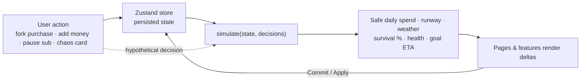

# AFTER₹10

**See the consequences before you spend.**

AFTER₹10 is a front-end personal finance simulator for Gen Z. It models a limited ₹10,000 budget over 30 days and shows how a purchase, a subscription, or a surprise expense changes your balance, daily allowance, savings goals, risk, and overall financial health, *before* you commit the money.

| | |
|---|---|
| **Type** | Single-page web app (React, runs entirely in the browser) |
| **Live demo** | https://after10.vercel.app/ |
| **Repository** | https://github.com/hrx0508/After10 |
| **Status** | Hackathon prototype, `v1.0.0` (from `package.json`) |

---

## Visual Preview

> No screenshots are committed yet. Add images to `docs/screenshots/` and replace the placeholders below. The most useful shots for judges:

| Screen | Why it matters |
|---|---|
| `` | Dashboard: balance, safe daily spend, health, risk, weather strip |
| `` | Three scenarios (Buy Now / Wait 2 Weeks / Cheaper) with deltas |
| `` | 30-day "money weather" forecast and storm shield |
| `` | Add Money modal with live preview of consequences |
| `` | Subscriptions Page |
| `` | Chaos Cards |
| `` | Saving Goals Page |
| `` | Calendar |
| `` | Activity Page |

---

## Project Overview

AFTER₹10 is for students and early earners who live on a fixed allowance or stipend. You start on Day 12 of a 30-day month with ₹6,480 left of ₹10,000, a set of upcoming bills, four subscriptions, and two savings goals. You can then:

- test a purchase as a **simulation** without changing your real numbers,
- see every dashboard metric update together,
- **commit** the decision (it becomes part of your month) or **discard** it.

All data is seeded demo data stored in your browser. There is no backend and no bank connection.

## Problem Statement

Most budgeting tools are post-mortem loggers: they show where money went after it is gone. A flat "₹10,000 ÷ 30 days" figure also ignores rent, recurring subscriptions, and savings commitments, so a student can look fine on Day 12 and be out of money by Day 25.

This project is a prototype built for a hackathon brief about helping Gen Z manage a ₹10,000 / 30-day budget with visible, interconnected consequences. It is a demonstration of the idea, not a validated product, and the README makes no claims about user research or market data.

## Solution and Approach

One pure function, `simulate(state, decisions)`, computes every number the UI shows. Pages are thin views over it. A hypothetical decision is passed in as an extra argument, so a "what if" and reality run through identical logic and can be compared side by side.

| Pain point | How the app addresses it |
|---|---|
| Flat daily budgets ignore bills | Safe Daily Spend subtracts upcoming bills, active subscriptions and goal contributions first |
| Impulse purchases hide their cost | Multiverse simulates a purchase and shows the change in daily spend, month-end balance, goal progress and survival odds |
| Subscriptions drain quietly | Subscription Radar shows how many days of runway you gain by pausing each one |
| Surprise expenses | Chaos Cards preview an emergency's impact before you apply it |
| Risk is abstract | Risk is shown as a survival probability and as a 30-day weather forecast |

## Key Features

All features below are implemented in the current code.

- **Dashboard (Home):** total balance (with hide toggle and balance-history sparkline), safe daily spend, primary savings goal ring, financial health tier, risk level, weather strip, and a health breakdown with a "Why did it change?" note.
- **Money Multiverse:** enter an item and price, then compare three scenarios: *Buy Now*, *Wait 2 Weeks*, and a *Cheaper* alternative. Each card shows changes in safe daily spend, month-end balance, goal progress and risk. **Commit This Decision** applies the selected one; **Discard** clears them with a particle effect. The Multiverse page adds a projected-balance chart and a Regret Meter (cost in days of safe spending, and goal delay).
- **Money Weather:** a 30-day strip (Good / Okay / Rain / Storm) derived from projected balance. When a scenario is selected, days that get worse are flagged. A storm-shield bar shows your lowest projected balance and whether a ₹1,000 surprise is absorbed.
- **Subscriptions:** select subscriptions and pause them in one action; per-subscription freeze/resume with the runway change shown.
- **Chaos Cards:** six preset shocks (e.g. Phone Repair −₹2,500, Freelance Payment +₹1,500). "Simulate Now" opens a before/after preview; applying it updates the balance and logs a transaction.
- **Savings Goals:** progress rings, ETA that reacts to spending, **Add ₹500**, adjust, and create goals.
- **Add Money:** add income or log an expense, with a live preview of the new balance, safe daily spend and survival odds.
- **Calendar:** October 2026 grid with weather, bills, and income/expense markers, plus a day detail panel and projected-balance chart.
- **Activity:** income/spending totals, balance history chart, spending by category, filterable transaction list.
- **Next day:** advances the month one day, deducting your daily pace and any bills due.
- **Settings:** daily spending pace slider and **Reset demo data**.
- **Persistence:** state is saved to `localStorage`.

## Innovation and Unique Value

- **One engine, many views.** Because every screen calls the same `simulate()`, a single decision changes the dashboard, forecast, goals, and health score together. This is what makes consequences "interconnected" rather than a set of separate widgets.
- **Comparable scenarios.** The Monte Carlo step uses a pre-generated, fixed set of random numbers (seeded), so scenarios are judged against the *same* random futures. Differences between scenarios come from the decision, not from sampling noise, and results are deterministic between renders.
- **Risk as a probability.** Instead of an arbitrary score, survival odds come from 300 simulated months (see below).
- **Preview-first interactions.** Add Money, Chaos Cards, and Multiverse all show consequences before applying them.

This is a client-side prototype built on simplified assumptions; the value is in the design of the interaction, not in financial accuracy.

## How It Works



### The model (`src/engine/simulate.js`)

- **Safe daily spend** = (balance − upcoming bills − goal reserve − decisions) ÷ days left. Upcoming bills are commitments plus *active* subscriptions due today or later. Goal reserve is each goal's monthly plan, capped at what remains to reach its target.
- **Projected balance** per day = balance − (daily pace × days) − bills due so far − decisions made so far. **Runway** = days left + month-end balance ÷ daily pace.
- **Weather** per day uses cushion days = (projected balance − goal reserve) ÷ pace: below 0 = Storm, below 3 = Rain, below 8 = Okay, otherwise Good.
- **Survival %** = share of 300 simulated months that never drop below ₹0. Each simulated day spends 0.7–1.3× your pace and has a 5% chance of a ₹300–₹1,500 unexpected expense. These parameters are assumptions, not data.
- **Health score (0–100)** = 35% budget sustainability (survival) + 20% commitment coverage + 25% emergency buffer (month-end balance relative to ₹2,000) + 20% savings progress. Tiers: Excellent ≥ 80, Good ≥ 60, Fair ≥ 40, otherwise Poor.
- **Risk level:** survival ≥ 75% = Low, ≥ 45% = Medium, otherwise High. Scenario cards use Good ≥ 60%, Moderate ≥ 40%, otherwise Critical.
- **Goal ETA** = remaining amount ÷ monthly contribution capacity × 30, where capacity is the funded reserve plus a share of any surplus.
- **Scenarios:** *Wait 2 Weeks* moves the purchase 14 days later (capped at Day 30), assumes 30% lower spending until then, and weights the purchase less in today's safe daily spend. *Cheaper* is 40% of the price, rounded to the nearest ₹10.

## Technology Stack

| Technology | Purpose | Where or how it is used |
|---|---|---|
| React `^19.3` | UI library | All components in `src/` |
| Vite `^8.3` + `@vitejs/plugin-react` | Dev server and bundler | `vite.config.js`, scripts `dev` / `build` / `preview` |
| Tailwind CSS `^4.3` (`@tailwindcss/vite`) | Styling | Utility classes; theme tokens and glass/blob/shimmer styles in `src/styles/index.css` |
| Framer Motion `^14.1` | Animation | Page transitions, animated numbers, rings, charts, modals, nav pill |
| React Router DOM `^7.18` | Routing | `HashRouter` with 8 routes in `src/App.jsx` |
| Zustand `^5.0` (+ `persist`) | State management | Slice-based store in `src/store/`, saved to `localStorage` |
| Lucide React `^1.55` | Icons | Navigation, cards, weather, buttons |
| Hand-written SVG | Charts | `AreaChart` and `Sparkline`; no charting library |
| Google Fonts (Space Grotesk) | Typography | Loaded by `index.html` (external, needs internet) |

No backend, database, or third-party API is used.

## Architecture and Project Structure

```text
after10/
├── index.html
├── package.json
├── vite.config.js
└── src/
    ├── main.jsx, App.jsx          # entry + router
    ├── engine/                    # pure logic, no React
    │   ├── simulate.js            #   the financial model
    │   ├── insights.js            #   Quick Insights text
    │   ├── history.js             #   balance history from transactions
    │   └── format.js              #   ₹ formatting, tiers, risk labels
    ├── data/seed.js               # demo state, categories, chaos cards
    ├── store/                     # Zustand store (index.js + slices/)
    │   └── slices/                #   ui · money · scenarios · subs · goals
    ├── hooks/useSim.js            # memoised views over the engine
    ├── components/
    │   ├── ui/                    # GlassCard, ProgressRing, DeltaChip, Modal, Toast…
    │   ├── charts/                # AreaChart, Sparkline
    │   └── layout/                # AppShell, Sidebar, Topbar, MobileNav, Ambient…
    ├── features/                  # one folder per feature
    │   └── dashboard · weather · multiverse · subscriptions · chaos
    │       goals · money · calendar · activity · settings
    ├── pages/                     # thin route pages composing features
    └── styles/index.css
```

Dependencies flow one way: **pages → features → components / hooks → store → engine**. The engine imports nothing from React.

## Getting Started

### Prerequisites

- Node.js `^20.19.0` or `>=22.12.0` (required by Vite 8)
- npm

No environment variables, accounts, or API keys are needed.

### Installation and running

```bash
git clone <your-repo-url>
cd after10
npm install
npm run dev
```

Open the URL Vite prints (usually `http://localhost:5173`).

### Scripts

| Command | Description |
|---|---|
| `npm run dev` | Start the development server |
| `npm run build` | Production build to `dist/` |
| `npm run preview` | Serve the production build locally |

## Usage

1. **Home:** read your safe daily spend and health tier.
2. **Multiverse panel:** keep "Concert Ticket / ₹1,500" or set your own item and price, press **Run Simulation**, click a scenario card, and compare the changes. Press **Commit This Decision** to apply it or **Discard** to drop it.
3. **Subscriptions widget:** toggle subscriptions, press **Pause Selected**, and watch safe daily spend rise.
4. **Chaos Cards:** pick a card, press **Simulate Now**, review the preview, and **Apply to my month**.
5. **Add Money** (top bar): log income or an expense.
6. **Next day** (top bar): move the month forward.
7. **Settings → Reset demo data:** restore the original state.

## Security and Privacy

- There is no authentication, server, or network API. Data never leaves the browser.
- State is stored **unencrypted** in `localStorage` under the key `after10-v2`.
- The only external request is the Google Fonts stylesheet in `index.html`.
- This is a prototype and has not been security-reviewed.

## Challenges and Technical Decisions

These are observable design choices in the code:

- **Single source of truth for numbers.** Centralising the model in `simulate()` avoids drift between screens.
- **Deterministic Monte Carlo.** A fixed seed and shared random numbers keep scenario comparisons stable.
- **Slice-based store.** Money, scenarios, subscriptions, goals, and UI state live in separate slices, composed in `src/store/index.js`.
- **Transaction log as ledger.** Every balance change logs a transaction, so balance history can be rebuilt from the log.
- **Hash routing.** `HashRouter` lets the static build run on any host without rewrite rules.
- **No chart library.** A small custom SVG chart keeps the bundle small and allows the animated "ghost line" and hover tooltip.
- **Reduced motion.** `index.css` disables animations when the user prefers reduced motion.

## Limitations and Known Issues

- **Demo data only.** A single seeded user; no real accounts or bank/UPI integration.
- **Calendar is fixed to October 2026**, and dates are labelled "Oct N".
- **Simplified model.** Spending is a single user-set daily pace; the shock probability and amounts in the Monte Carlo are assumptions. Outputs are illustrative and not financial advice.
- **Primary goal only** drives the stat card, Savings Goal widget and scenario "Goal Progress" (the first goal in the list).
- **No automated tests or linting** are configured.
- **No screenshots, license, or deployment** are included yet.
- The month ends at Day 30; there is no multi-month mode or undo.
- The production bundle is ~484 kB (about 154 kB gzipped).

## Future Improvements

- Unit tests for `simulate()` (health, ETA, scenario edge cases), plus component tests.
- Month/date handling that is not hard-coded, and multi-month support.
- Per-category daily pace learned from the transaction log, instead of one global pace.
- Editable commitments and subscriptions in the UI.
- Export and import of data, and optional backend sync.
- Code-splitting routes to reduce the initial bundle.

## Testing and Quality Assurance

- No automated test suite is included.
- `npm run build` completes successfully (Vite 8, Node 22).
- The engine's outputs were spot-checked with ad hoc Node scripts during development; those scripts are not part of the repository.
- The UI has not been through formal cross-browser or accessibility testing.

## Deployment

The app is a static site. No deployment is configured yet.

```bash
npm run build      # outputs dist/
```

Upload `dist/` to any static host (Netlify, Vercel, GitHub Pages, etc.). Hash routing means no server rewrite rules are required. No environment variables are needed.

## Contributing

1. Fork and clone the repository.
2. Create a branch: `git checkout -b feature/your-change`.
3. Run `npm install` and `npm run dev`; verify with `npm run build`.
4. Commit and open a pull request describing the change.

## Acknowledgements

Built with [React](https://react.dev), [Vite](https://vite.dev), [Tailwind CSS](https://tailwindcss.com), [Framer Motion](https://www.framer.com/motion/), [React Router](https://reactrouter.com), [Zustand](https://zustand.docs.pmnd.rs) and [Lucide](https://lucide.dev). Typography: Space Grotesk via Google Fonts. The dashboard layout follows a concept mockup supplied for this project.

## License

No license has been specified. Until one is added, all rights are reserved by the authors by default. Add a `LICENSE` file to make the terms explicit.
